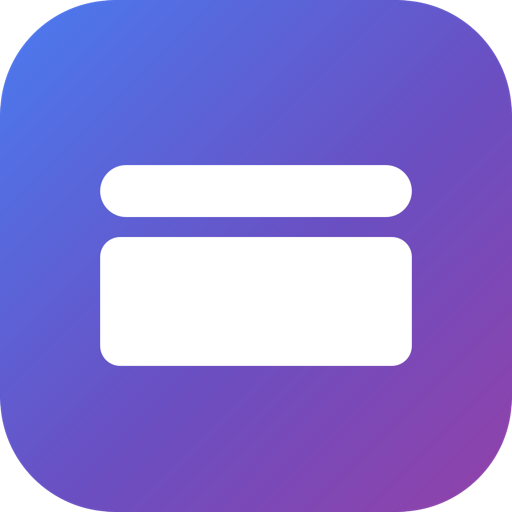
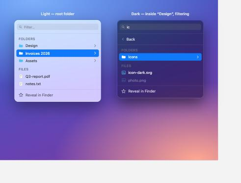

<p align="center">
  
</p>

<h1 align="center">FolderBar</h1>

<p align="center">Menu-bar folder shortcuts for macOS.</p>

<p align="center">
  <a href="https://github.com/EdiBianco/folderbar-mac/releases/latest">
    <strong>Download the latest release →</strong>
  </a>
</p>

Pick a folder, it becomes its own menu-bar dropdown — a live, filterable
listing of that folder's contents, one click away, no Finder window needed.

## Look & feel

A translucent, tinted glass panel (not a stock `NSMenu`) with a live filter
field, folders grouped ahead of files, and a rounded accent-blue highlight on
hover — light and dark shown below:



## Features

- **One menu bar item per folder** — add as many as you like via "Add
  Folder…"; drag the folder's contents straight open.
- **Live filter** — type to narrow the list as you go, no separate search
  step.
- **Folders first, drill-in navigation** — click into a subfolder in place,
  a "Back" row takes you up; folders are always grouped ahead of files.
- **Right-click a folder icon** for **Change Source Folder…** or **Remove**,
  without disturbing the normal left-click listing.
- **Open at Login** toggle (via `SMAppService`, no legacy helper bundle).
- **About panel** with version and author, plus **Check for Updates…**
  against GitHub Releases with a direct download link.
- Sandboxed, with persisted folder access via security-scoped bookmarks.
- Free, no trial, no in-app purchase.

## Build

CI builds a universal (arm64 + x86_64) `.app` on every push via GitHub
Actions (`.github/workflows/build.yml`); grab it from the workflow's
Artifacts tab, or from a tagged
[release](https://github.com/EdiBianco/folderbar-mac/releases/latest)
(`.github/workflows/release.yml`, triggered by pushing a `v*.*.*` tag).

To build locally:

```bash
swift build -c release --arch arm64 --arch x86_64
```
